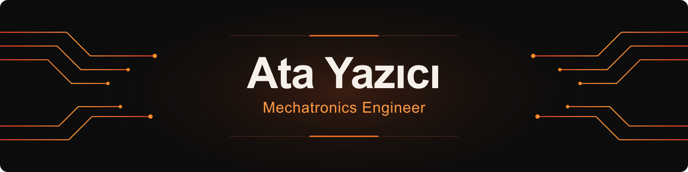
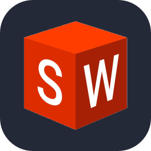
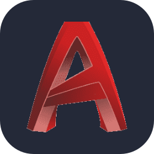
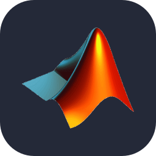

  

  &nbsp;&nbsp;
  &nbsp;&nbsp;
  &nbsp;&nbsp;
  &nbsp;&nbsp;
  &nbsp;&nbsp;
  &nbsp;&nbsp;
  &nbsp;&nbsp;
  

  SolidWorks · AutoCAD · Ansys · MATLAB · Simulink · Python · Codex · Claude Code

I am a mechatronics engineer with academic and hands-on experience in mechanical design, engineering analysis, control systems, and manufacturing processes.

My work combines mechanical design and analysis with contributions to control system modeling and simulation.

## Technical Skills

- **Mechanical Design:** SolidWorks, AutoCAD, technical drawing
- **Engineering Analysis:** Static and dynamic analysis, FEA
- **Control & Simulation:** MATLAB, Simulink, PID, LQR, state-space modeling
- **Programming:** Python
- **AI-Assisted Development:** Terminal-Based AI Coding Agents, Multi-Agent Workflows

## Selected Projects

### 
Mechanical design, fastener selection and design, and static and dynamic analyses of a UAV using UWB and LiDAR technologies. Supported control system development using MATLAB/Simulink. Presented the project methodology and simulation results at MEKON 2026.

### 
Mechanical design and dynamic balance analysis in SolidWorks. Supported the development of the Arduino-based control system.

### 
Smart home automation project covering system block diagrams, component selection, and operating scenarios. Initial software development is underway.

This portfolio showcases selected engineering projects through summaries, diagrams, analysis results, and simulation media.
<!--
**AtaYazici-539/AtaYazici-539** is a ✨ _special_ ✨ repository because its `README.md` (this file) appears on your GitHub profile.

Here are some ideas to get you started:

- 🔭 I’m currently working on ...
- 🌱 I’m currently learning ...
- 👯 I’m looking to collaborate on ...
- 🤔 I’m looking for help with ...
- 💬 Ask me about ...
- 📫 How to reach me: ...
- 😄 Pronouns: ...
- ⚡ Fun fact: ...
-->
